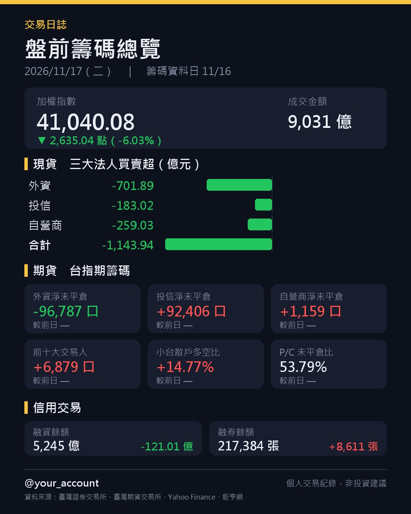
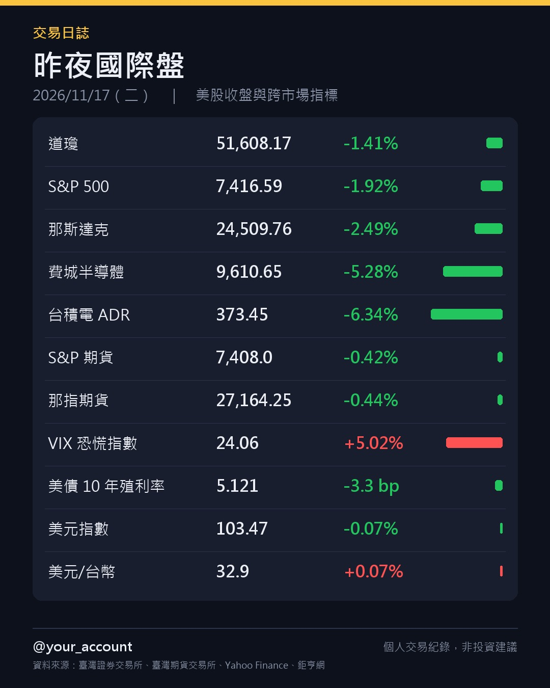
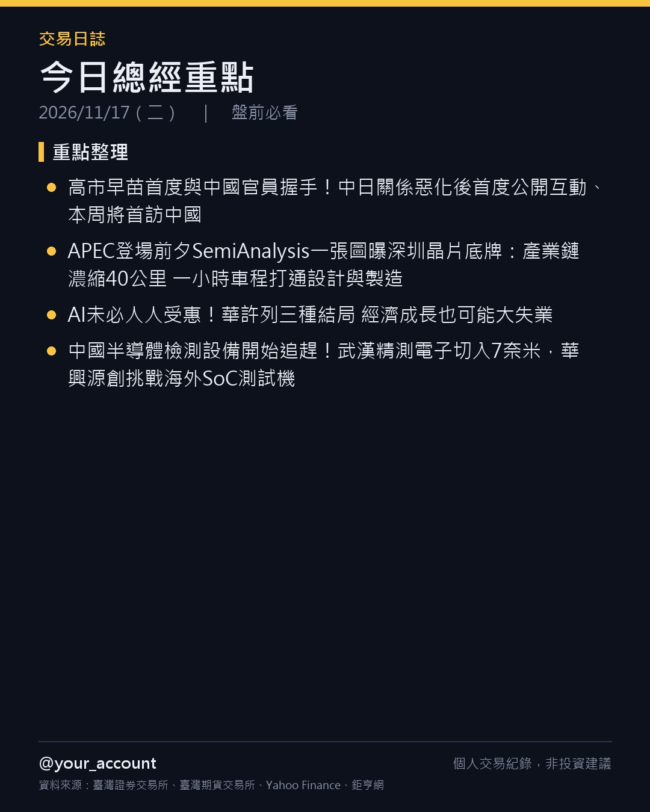
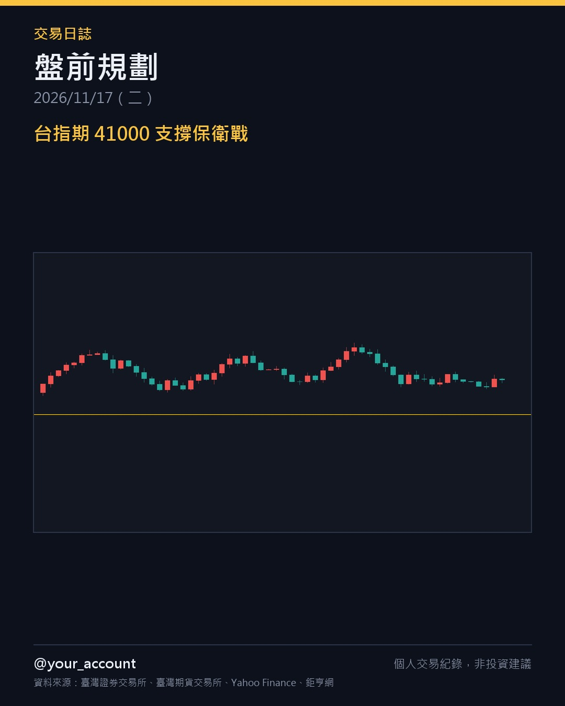

# 交易日誌粉專自動發文機器人

每天早上自動抓**台股籌碼**、**國際盤**、**總經新聞**，用 Claude 整理成貼文，畫好圖卡，
開一份草稿給你看；你在手機上留言 `/publish`，就同時發到 **Instagram** 和 **Threads**。

你自己畫的 **TradingView 盤前規劃**，也可以用同一套流程投稿、套版、發文。

| 籌碼總覽 | 國際盤 | 總經重點 | 盤前規劃 |
|---|---|---|---|
|  |  |  |  |

---

## 每天的流程

```
07:00（週一～五，休市日自動跳過）
  └─ GitHub Actions 自動執行
       ├─ 證交所：三大法人買賣超、融資融券、加權指數
       ├─ 期交所：三大法人台指期未平倉、前十大交易人、小台散戶多空比、P/C ratio
       ├─ Yahoo Finance：美股四大指數、台積電 ADR、美債殖利率、VIX、美元
       ├─ 鉅亨網：近 18 小時新聞標題
       ├─ Claude：上網查今日經濟數據行事曆，寫 Threads / IG 文案
       └─ 畫 3 張圖卡 → 在 repo 開一個「草稿 issue」

你（手機打開 GitHub App 就能看）
  ├─ 想改字 → 直接編輯 issue 裡的文字區塊
  └─ 留言 /publish → 自動發到 IG + Threads，並回覆貼文連結
```

**盤前規劃**：在 repo 按 `Issues → New issue → 📈 盤前規劃`，填標題、內容、貼上 TradingView 截圖送出。
大約 1 分鐘後會出現一份新草稿，一樣留言 `/publish` 就發出去。你的文字**會照原文發出**，不會被 AI 改寫。

### 留言指令

| 指令 | 作用 |
|---|---|
| `/publish` | 同時發到 IG 和 Threads |
| `/publish threads` | 只發 Threads |
| `/publish ig` | 只發 IG |
| `/skip` | 這篇不發，關閉草稿 |

只有 repo 擁有者（你）的留言有效，別人留言不會觸發。

---

## 一次性設定（約 30–60 分鐘）

### 1. 建立 GitHub repo

1. 到 GitHub 建一個新的 repository，**設成 Public**。
   因為 IG 的 API 只能從公開網址抓圖片，圖卡會放在 repo 裡，再用公開網址交給 IG。
   （草稿和歷史數據也會公開，但這些本來就是要發出去的內容。）
2. 把這個資料夾的所有檔案 push 上去。
3. `Settings → Actions → General → Workflow permissions` 選 **Read and write permissions**，存檔。

### 2. 設定 Secrets

`Settings → Secrets and variables → Actions → New repository secret`，新增：

| 名稱 | 內容 | 必填 |
|---|---|---|
| `ANTHROPIC_API_KEY` | Claude API 金鑰（[console.anthropic.com](https://console.anthropic.com) 申請） | 建議（沒設會用固定模板） |
| `IG_ACCESS_TOKEN` | Instagram 長效權杖（見下方） | 要發 IG 才需要 |
| `THREADS_ACCESS_TOKEN` | Threads 長效權杖（見下方） | 要發 Threads 才需要 |
| `GH_PAT` | 讓機器人每週自動展延權杖用（見下方） | 建議 |

### 3. 取得 Instagram 權杖

前提：你的 IG 帳號要切成**專業帳號**（創作者或商家都可以），`設定 → 帳號類型和工具`。

1. 到 [developers.facebook.com](https://developers.facebook.com) 註冊開發者，按「建立應用程式」。
2. 使用案例選 **「管理 Instagram 上的訊息和內容」**（Instagram API）。
3. 進到「使用 Instagram 登入的 API 設定」，在「產生存取權杖」新增你的 IG 帳號並登入授權。
   權限要包含 `instagram_business_basic`、`instagram_business_content_publish`。
4. 複製產生的權杖，貼到 Secret `IG_ACCESS_TOKEN`。這是 60 天的長效權杖。

應用程式維持「開發模式」就可以發到你自己的帳號，**不需要送審**。

### 4. 取得 Threads 權杖

1. 在開發者後台另外建一個應用程式，使用案例選 **「存取 Threads API」**。
   （Threads 的使用案例通常不能和其他使用案例放在同一個應用程式裡。）
2. 權限加入 `threads_basic`、`threads_content_publish`。
3. 「應用程式角色 → 角色」把你的 Threads 帳號加為 **Threads 測試人員**，
   然後在 Threads App 裡：`設定 → 帳號 → 網站權限 → 邀請`，接受邀請。
4. 用後台的權杖產生工具（或 Graph API 測試工具，切換到 threads.net）取得**短效權杖**，再換成長效權杖：

   ```bash
   curl "https://graph.threads.net/access_token?grant_type=th_exchange_token&client_secret=你的App密鑰&access_token=短效權杖"
   ```

   回傳的 `access_token` 貼到 Secret `THREADS_ACCESS_TOKEN`。

> Meta 後台介面常改版，按鈕名稱可能和上面不完全一樣。卡住的話，請參考 Meta 官方文件
> 「Instagram API with Instagram Login」和「Threads API → Get Started」。

### 5. 權杖自動展延（建議）

IG 和 Threads 的權杖 60 天就會過期。`展延 IG / Threads 權杖` 這個 workflow 每週日會自動展延，並把新的權杖寫回 Secrets。
它需要一把 GitHub 權杖：

1. GitHub 右上角頭像 → `Settings → Developer settings → Personal access tokens → Fine-grained tokens → Generate new token`
2. Repository access 只選這個 repo；Permissions 裡把 **Secrets** 設成 **Read and write**
3. 產生後貼到 Secret `GH_PAT`

### 6. 試跑

1. `Actions → 每日盤前草稿 → Run workflow`（休市日想測試可以勾「休市日也產生」）。
   第一次執行也會順便建立 `draft`、`plan` 等標籤；**盤前規劃表單需要先有 `plan` 標籤才會觸發**，所以請先跑這一步。
2. 到 `Issues` 看草稿，確認圖卡和文字。
3. 留言 `/publish threads` 先發 Threads 試試看。

---

## 個人化設定

改 [`config.toml`](config.toml) 就好，不用碰程式：

- `brand.name`、`brand.handle`：圖卡上的粉專名稱和帳號
- `brand.hashtags`：IG hashtag
- `brand.support_link`：斗內連結（例如 Portaly、Buy Me a Coffee），會自動加在 IG 文末
- `claude.voice`：你的寫作風格
- `claude.model`、`claude.effort`：想省錢可以把模型改成 `claude-sonnet-5-5`

發文時間：改 [`.github/workflows/daily-draft.yml`](.github/workflows/daily-draft.yml) 裡的 `cron`（注意是 UTC 時間，台灣時間要減 8 小時）。
GitHub 的排程常會延遲 5–30 分鐘，所以預設 07:00 產生，給你時間在開盤前看完。

---

## 費用

- **GitHub Actions**：public repo 免費。
- **Claude API**：每天一次，含上網搜尋，粗估每天新台幣幾塊到十幾塊（依新聞量而定）。可以在 Anthropic Console 設定每月花費上限。
- **Meta API**：免費。

## 本機預覽

```bash
pip install -r requirements.txt
python -m bot daily --force
```

會在 `posts/<日期>/premarket/` 產生圖卡和文字（不會發文、也不會動到 GitHub）。

---

## ⚠️ 法規提醒

在台灣，沒有投顧執照卻公開對特定有價證券提供分析意見、**又收取報酬**，可能觸犯《證券投資信託及顧問法》（非法經營投顧業務）。

這個工具已經盡量降低風險：

- 每篇貼文自動加免責聲明
- Claude 被要求不寫買賣建議、目標價，也不點名推薦個股
- 內容定位為「個人交易日誌」

但**斗內收入**和**個股分析**是比較敏感的組合。開始收斗內前，建議先找律師或專業人士確認。

## 資料來源

臺灣證券交易所、臺灣期貨交易所開放資料、Yahoo Finance、鉅亨網。資料若有延遲或錯誤，以官方公告為準。
